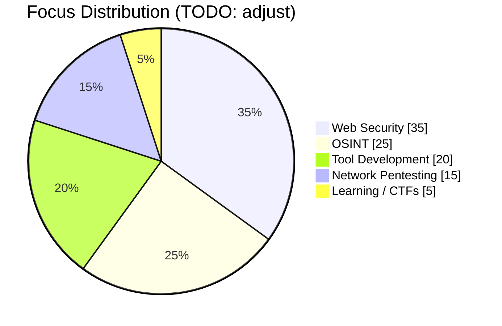
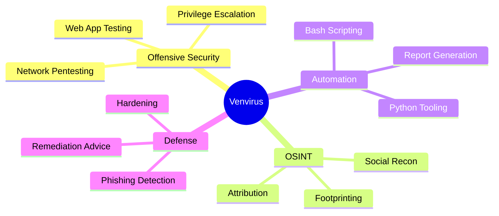
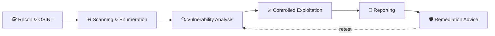

<!-- ============================================================
  Profile README for github.com/Venvirus
  Save this as README.md inside a PUBLIC repo named exactly: Venvirus/Venvirus
  Search for "TODO" to find the placeholders you need to fill in.
============================================================= -->

<!-- HEADER -->
<p align="center">
  
</p>

<p align="center">
  
</p>

<p align="center">
  
  
  
  
</p>

<p align="center">
  <a href="#-about-me">About</a> •
  <a href="#-cyber-arsenal">Arsenal</a> •
  <a href="#-featured-projects">Projects</a> •
  <a href="#-skill-levels">Skills</a> •
  <a href="#-methodology">Methodology</a> •
  <a href="#-recon-cheat-sheet">Cheat Sheet</a> •
  <a href="#-training-grounds">Training</a> •
  <a href="#-security-engagements">Engagements</a> •
  <a href="#-github-analytics">Stats</a> •
  <a href="#-fun-zone">Fun Zone</a> •
  <a href="#-resources">Resources</a> •
  <a href="#-faq">FAQ</a> •
  <a href="#-services">Services</a> •
  <a href="#-lets-connect">Contact</a>
</p>

<!-- Terminal: works without uploading any file. (assets/terminal.svg is an optional offline alternative.) -->
<p align="center">
  
</p>

---

## 🧠 About Me

<table>
<tr>
<td width="55%" valign="top">

```bash
venvirus@cyberlab:~$ whoami
> Cybersecurity Researcher
> Ethical Hacker
> OSINT Investigator
> Security Automation Developer

venvirus@cyberlab:~$ cat mission.txt
> Find the weakness before the attacker does.
> Turn findings into fixes people can actually use.
```

</td>
<td width="45%" valign="top">

**🎯 Focus areas**

- 🔐 Penetration Testing
- 🌐 Web Application Security
- 🕵️ OSINT & Threat Intelligence
- ⚙️ Security Automation & Tooling
- 📝 Vulnerability Reporting & Remediation

</td>
</tr>
</table>

### ⚡ Quick Facts

- 🔭 **Currently working on:** expanding PhishFinder's detection capabilities <!-- TODO: edit -->
- 🌱 **Currently learning:** advanced web exploitation, Active Directory attacks, cloud security <!-- TODO: edit -->
- 🤝 **Open to:** security collaborations, bug bounty teams, open-source contributions
- 💬 **Ask me about:** recon workflows, OSINT techniques, Python security tooling
- 📍 **Based in:** Malawi 🇲🇼 <!-- TODO: edit or remove -->

### 🖥 System Profile

```text
 ┌──────────────────────────────────────────────────────────┐
  venvirus@cyberlab
  ─────────────────
  Role ........ Cybersecurity Researcher / Ethical Hacker
  Specialty ... Web App Security • OSINT • Automation
  Languages ... Python, JavaScript, C++, Bash
  OS .......... Kali Linux, Parrot Security
  Lab ......... Docker containers, TryHackMe, HackTheBox
  Editor ...... TODO: VS Code / Neovim
  Status ...... 🟢 Online, open to collaboration
 └──────────────────────────────────────────────────────────┘
```

<p align="right"><a href="#">⬆ back to top</a></p>

---

## ⚔️ Cyber Arsenal

### 💻 Languages

<p>
  
</p>

### 🧰 Security Toolkit

<details open>
<summary><b>🌐 Network Reconnaissance</b></summary>
<br>


</details>

<details open>
<summary><b>🕸 Web Security Testing</b></summary>
<br>


</details>

<details>
<summary><b>⚔️ Exploitation Frameworks</b></summary>
<br>


</details>

<details>
<summary><b>🔐 Password Auditing</b></summary>
<br>


</details>

<details>
<summary><b>📡 Network Analysis</b></summary>
<br>


</details>

<details>
<summary><b>🕵️ OSINT Intelligence</b></summary>
<br>


</details>

<details>
<summary><b>🧪 Lab Environments</b></summary>
<br>


</details>

<details>
<summary><b>🧭 Also exploring</b> <sub>(TODO: keep only what you use)</sub></summary>
<br>


</details>

---

## 📶 Skill Levels

<!-- TODO: adjust these to an honest self-assessment. -->

| Skill | Level | Focus |
|:------|:------|:------|
| 🕸 Web App Pentesting | `████████░░` 80% | OWASP Top 10, auth & session flaws |
| 🌐 Network Pentesting | `███████░░░` 70% | Recon, enumeration, services |
| 🕵️ OSINT | `█████████░` 90% | Footprinting, attribution, mapping |
| 🐍 Python Automation | `████████░░` 80% | Recon scripts, parsers, tooling |
| 🐧 Linux & Bash | `████████░░` 80% | Scripting, hardening, privesc |
| ⬆️ Privilege Escalation | `██████░░░░` 60% | Linux & Windows paths |
| ☁️ Cloud Security | `███░░░░░░░` 30% | Currently learning |

<details>
<summary><b>🧩 Where my time goes</b></summary>
<br>



</details>

<details>
<summary><b>🗺 Skill map</b></summary>
<br>



</details>

<p align="right"><a href="#">⬆ back to top</a></p>

---

## 🚀 Featured Projects

<table>
<tr>
<td width="50%" valign="top">

### 🎣 [PhishFinder](https://github.com/Venvirus/PhishFinder)

Phishing detection and analysis tool.

- 🔗 URL pattern analysis
- 🌍 Domain intelligence
- ↪️ Redirect-chain detection

<a href="https://github.com/Venvirus/PhishFinder">
  
</a>

</td>
<td width="50%" valign="top">

### 📚 [AwesomeSec](https://github.com/Venvirus/AwesomeSec)

Curated cybersecurity resources.

- 🛠 Penetration testing tools
- 🕵️ OSINT resources
- 📖 Security research materials

<a href="https://github.com/Venvirus/AwesomeSec">
  
</a>

</td>
</tr>
</table>

<p align="center">
  <a href="https://github.com/Venvirus/PhishFinder">
    
  </a>
  <a href="https://github.com/Venvirus/AwesomeSec">
    
  </a>
</p>

### 🗺 Roadmap

- [x] URL pattern analysis & redirect detection
- [x] Curated security resource library
- [ ] Add reporting output (JSON / HTML) to PhishFinder <!-- TODO: edit to match your real plans -->
- [ ] Add automated recon scripts to the repo list
- [ ] Publish write-ups of CTF and lab walkthroughs

### 💡 Tool Ideas Backlog

<!-- TODO: edit to what you genuinely plan to build. -->

| Idea | Purpose | Status |
|:-----|:--------|:------:|
| 🔎 Recon Toolkit | One-command passive recon (subdomains, emails, tech stack) | 💭 Idea |
| 📄 Report Builder | Turn findings into a clean Markdown / PDF report | 💭 Idea |
| 🕵️ OSINT Dashboard | Aggregate public-footprint results in one view | 💭 Idea |
| 🛡 Header Auditor | Check HTTP security headers and flag gaps | 💭 Idea |
| 🎣 PhishFinder 2.0 | Scoring engine and exportable reports | 🚧 Planned |

---

## 🧭 Methodology

Every engagement follows a structured, repeatable process:



| Phase | What happens | Typical tools |
|:------|:-------------|:--------------|
| **1. Recon & OSINT** | Map the public footprint, domains, emails, exposed info | theHarvester, Amass, SpiderFoot, Sherlock |
| **2. Scanning** | Discover hosts, ports, services, technologies | Nmap, Masscan, Nikto |
| **3. Analysis** | Identify and prioritise weaknesses | Burp Suite, OWASP ZAP, Searchsploit |
| **4. Exploitation** | Safely validate impact within the agreed scope | Metasploit, custom scripts |
| **5. Reporting** | Clear findings, risk ratings, proof of concept | Markdown / PDF reports |
| **6. Remediation** | Practical fixes and retesting | Hardening guidance |

---

## 📓 Recon Cheat Sheet

> ⚠️ Use only on systems you own or have written permission to test.

<details>
<summary><b>🌐 Network scanning (Nmap)</b></summary>

```bash
# Fast top-ports scan
nmap -T4 --top-ports 1000 <target>

# Service + version detection with default scripts
nmap -sV -sC -oA scan_results <target>

# Full TCP port sweep
nmap -p- --min-rate 1000 <target>
```

</details>

<details>
<summary><b>🔎 Subdomain & OSINT recon</b></summary>

```bash
# Passive subdomain enumeration
amass enum -passive -d example.com

# Emails and hosts from public sources
theHarvester -d example.com -b all

# Username lookup across social platforms
sherlock <username>
```

</details>

<details>
<summary><b>🕸 Web checks</b></summary>

```bash
# Quick web server misconfiguration scan
nikto -h https://example.com

# Look up known exploits for a discovered service
searchsploit "apache 2.4"
```

</details>

<details>
<summary><b>📝 Findings report template</b></summary>

```markdown
## Finding: <Title>
- **Severity:** Critical / High / Medium / Low / Info
- **Affected asset:** <URL / host>
- **Description:** What the issue is and why it matters
- **Steps to reproduce:** 1... 2... 3...
- **Impact:** What an attacker could achieve
- **Remediation:** Specific fix and references (OWASP / CWE)
```

</details>

<p align="right"><a href="#">⬆ back to top</a></p>

---

## 🧪 Training Grounds

<p align="center">
  
</p>

<p align="center">
  
  
  
  
  
</p>

**🎯 Skills practiced**

| 🕸 Web Exploitation | 🌐 Network Pentesting | 🕵️ OSINT | ⬆️ Privilege Escalation | 🔎 Vuln Discovery |
|:---:|:---:|:---:|:---:|:---:|
| SQLi, XSS, auth flaws | Recon, services, pivoting | Footprinting, attribution | Linux & Windows paths | Scanning & manual review |

<!-- TODO: add your real profile links, e.g.
<p align="center">
  <a href="https://tryhackme.com/p/YOUR_USERNAME"></a>
</p>
-->

### 🏁 CTF & Lab Log

<!-- TODO: replace with real entries. Delete the examples. -->

| Date | Platform | Challenge / Room | Category | Write-up |
|:----:|:---------|:-----------------|:--------:|:--------:|
| TODO | TryHackMe | _Room name_ | Web | 🔜 |
| TODO | HackTheBox | _Machine name_ | Linux / Privesc | 🔜 |
| TODO | picoCTF | _Challenge name_ | Forensics | 🔜 |

### 🐞 Bug Bounty Platforms

<!-- TODO: link only profiles you actually have. -->
<p>
  
  
  
</p>

> ### 🧬 Hacker's Code
> 1. **Permission first.** No scope, no test.
> 2. **Do no harm.** Prove impact without causing damage or leaking data.
> 3. **Disclose responsibly.** Report privately, give time to fix.
> 4. **Share knowledge.** Teach what I learn.
> 5. **Never stop learning.**

<p align="right"><a href="#">⬆ back to top</a></p>

---

## 🛡 Security Engagements

<p align="center">
  
</p>

| 🏢 Organization | 🔎 Scope | ✅ Activities |
|:----------------|:---------|:--------------|
| 🏫 **Mubarak Complex College** | Web & system security | Vulnerability assessment • web security testing • security recommendations |
| 🎓 **Free Online Madrasa** | Web security, authentication | Penetration testing • authentication review • configuration security |
| 💻 **NiffaTech** | Digital systems | Vulnerability scanning • system risk assessment • attack surface analysis |
| 🌍 **AfriTongues** | Website security posture | Cyber audit • exploit-point review • defensive improvements |

> ### ⚠️ Ethical Notice
> All testing was performed **with permission** and strictly for the purpose of improving system security.
> I follow responsible disclosure and never test systems I don't have authorization to assess.

---

## 🎮 Fun Zone

<p align="center">
  
</p>

```text
 _    _________   ___    __________  __  _______
| |  / / ____/ | / / |  / /  _/ __ \/ / / / ___/
| | / / __/ /  |/ /| | / // // /_/ / / / /\__ \ 
| |/ / /___/ /|  / | |/ // // _, _/ /_/ /___/ / 
|___/_____/_/ |_/  |___/___/_/ |_|\____//____/
```

### 🪪 Hacker ID Card

<!-- TODO: edit the values. -->

| | |
|:--|:--|
| 🕶 **Codename** | `Venvirus` |
| 🎩 **Class** | Ethical Hacker / Security Researcher |
| ⚪ **Alignment** | White Hat |
| 🛡 **Clearance** | Authorized targets only |
| ⭐ **Level** | 7 `[███████░░░]` |
| ✨ **Special move** | Passive recon → targeted testing → clean report |
| 🧪 **Home base** | Kali Linux + Docker lab |

### 🧙 Character Sheet

<!-- TODO: adjust the stats. -->

| Stat | Points | Meaning |
|:-----|:-------|:--------|
| 🕵️ **Recon** | `██████████` 10/10 | Finds what's exposed |
| 🕸 **Web-fu** | `████████░░` 8/10 | Breaks (authorized) web apps |
| 🐍 **Scripting** | `████████░░` 8/10 | Automates the boring parts |
| 🌐 **Network** | `███████░░░` 7/10 | Knows where the packets go |
| 📝 **Reporting** | `████████░░` 8/10 | Turns findings into fixes |
| ☁️ **Cloud** | `███░░░░░░░` 3/10 | Skill tree unlocking soon |

### 🏅 Achievements Unlocked

<!-- TODO: tick what is true. -->
- [x] 🥇 **First Blood**: published my first security tool
- [x] 🎣 **Phish Hunter**: built PhishFinder
- [x] 📚 **Librarian**: curated AwesomeSec
- [x] 🧪 **Lab Rat**: set up a Kali + Docker lab
- [ ] 🐞 **Bounty Hunter**: first valid bug bounty report
- [ ] 🎓 **Certified**: earn first certification
- [ ] 🎤 **Speaker**: give a security talk
- [ ] ⭐ **Rising Star**: 100 stars across repos

### 🚩 Mini CTF: Can You Solve It?

Three quick levels. Decode each message to reach the next. The final one is a flag.

<details>
<summary><b>🟢 Level 1</b></summary>

```text
TmljZSBvbmUhIExldmVsIDIgdXNlcyBST1QxMy4=
```
_Hint: the "=" at the end is a clue. Try `echo '<text>' | base64 -d`._
</details>

<details>
<summary><b>🟡 Level 2</b></summary>

```text
Terng! Yriry 3 vf urk. Xrrc tbvat, unpxre.
```
_Hint: a Caesar cipher with a shift of 13._
</details>

<details>
<summary><b>🔴 Level 3</b></summary>

```text
56454e56495255537b77336c636f6d655f74305f7468335f6c34627d
```
_Hint: every two characters are one byte. Try `echo '<text>' | xxd -r -p`._
</details>

Solved it? [**Submit the flag via an issue**](https://github.com/Venvirus/Venvirus/issues/new?title=Flag%20submission&body=My%20flag%3A%20) and I'll add you to the Hall of Fame.

**🏆 Hall of Fame:** _be the first!_

### 🎲 Two Truths and a Lie

<!-- TODO: write your own. Reader guesses which is false. -->
<details>
<summary>Guess the lie</summary>

1. I built a phishing detector.
2. I curate a list of security resources.
3. I have never opened a terminal.

<details><summary>Answer</summary>

Number 3, of course. 😄
</details>
</details>

### 😂 Cyber Joke of the Moment

<p align="center">
  
</p>

### 🕹 Command Menu

```bash
$ ./menu.sh
```

| Command | Action |
|:--------|:-------|
| `./projects.sh` | [🚀 See my projects](#-featured-projects) |
| `./cheatsheet.sh` | [📓 Open the recon cheat sheet](#-recon-cheat-sheet) |
| `./learn.sh` | [📚 Browse resources](#-resources) |
| `./hire.sh` | [🛠 View services](#-services) |
| `./contact.sh` | [🤝 Get in touch](#-lets-connect) |

<!-- 🥚 Easter egg: if you're reading the source, you're my kind of person. Say hi in an issue and mention "source-diver". -->

<p align="right"><a href="#">⬆ back to top</a></p>

---

## 📊 GitHub Analytics

<p align="center">
  
  
</p>

<p align="center">
  
</p>

<details>
<summary><b>🏆 Trophies</b></summary>
<br>
<p align="center">
  
</p>
</details>

<details>
<summary><b>📈 Activity graph</b></summary>
<br>
<p align="center">
  
</p>
</details>

<details>
<summary><b>🐍 Contribution snake</b></summary>
<br>
<p align="center">
  
</p>
<!-- Requires .github/workflows/snake.yml to run once (Actions tab → Generate Contribution Snake → Run workflow). -->
</details>

---

## 🎓 Certifications & Learning Path

<!-- TODO: replace with certifications you actually hold or are working toward. Delete rows you don't need. -->

| Status | Certification / Course |
|:------:|:-----------------------|
| 🎯 Goal | eJPT (eLearnSecurity Junior Penetration Tester) |
| 🎯 Goal | CompTIA Security+ |
| 🎯 Goal | PNPT (Practical Network Penetration Tester) |
| 📚 In progress | TryHackMe learning paths / PortSwigger Web Security Academy |

---

## 📚 Resources

<details open>
<summary><b>📖 Recommended reading</b></summary>

- *The Web Application Hacker's Handbook*, Stuttard & Pinto
- *Hacking: The Art of Exploitation*, Jon Erickson
- *Black Hat Python*, Justin Seitz
- *Real-World Bug Hunting*, Peter Yaworski

</details>

<details open>
<summary><b>🌐 Free learning</b></summary>

- [PortSwigger Web Security Academy](https://portswigger.net/web-security)
- [OWASP Top 10](https://owasp.org/www-project-top-ten/)
- [OSINT Framework](https://osintframework.com)
- [TryHackMe](https://tryhackme.com) · [Hack The Box](https://www.hackthebox.com) · [picoCTF](https://picoctf.org)
- [AwesomeSec](https://github.com/Venvirus/AwesomeSec), my own curated list

</details>

<p align="right"><a href="#">⬆ back to top</a></p>

---

## 📝 Latest Writing

<!-- TODO: link your blog, Medium, or Dev.to. Automate with a "blog-post-workflow" GitHub Action if you want. -->
<!-- BLOG-POST-LIST:START -->
- 🧾 _Coming soon: CTF write-ups, OSINT workflows, and tool walkthroughs_
<!-- BLOG-POST-LIST:END -->

<sub>This list updates automatically once the blog workflow in `.github/workflows/` is set up.</sub>

---

## 🛠 Services

| Service | What you get |
|:--------|:-------------|
| 🔐 **Web Application Security Review** | Vulnerability assessment with prioritised findings and fixes |
| 🌐 **Network & Attack Surface Analysis** | Exposure mapping, scanning, and risk assessment |
| 🕵️ **OSINT Investigation** | Public-footprint analysis and exposed-data review |
| ⚙️ **Custom Security Tooling** | Python automation for recon, detection, and reporting |
| 📚 **Security Awareness Notes** | Plain-language guidance for non-technical teams |

> 📩 All engagements require a **written scope and permission** before any testing begins.

---

## ❓ FAQ

<details>
<summary><b>Do you test systems without permission?</b></summary>
<br>
Never. Every engagement needs a written scope and authorization first.
</details>

<details>
<summary><b>Can you review my website or app?</b></summary>
<br>
Yes. See <a href="#-services">Services</a> and reach out through <a href="#-lets-connect">Contact</a> with a short description of what you'd like reviewed.
</details>

<details>
<summary><b>How do I start in cybersecurity?</b></summary>
<br>
Learn Linux, networking, and one scripting language (Python is a great pick), then practice on TryHackMe and PortSwigger Academy. See <a href="#-resources">Resources</a>.
</details>

<details>
<summary><b>I found a vulnerability in one of your projects.</b></summary>
<br>
Thank you! Please follow the <a href="#-responsible-disclosure">Responsible Disclosure</a> steps.
</details>

---

## 🔒 Responsible Disclosure

If you find a security issue in any of my projects, please report it privately through
[GitHub Security Advisories](https://github.com/Venvirus/PhishFinder/security/advisories/new)
or by email rather than opening a public issue. I aim to acknowledge reports promptly and credit researchers who help.

<!-- TODO (optional): add your PGP key
**PGP fingerprint:** `XXXX XXXX XXXX XXXX XXXX  XXXX XXXX XXXX XXXX XXXX`
-->

---

## ⭐ Support the Work

- ⭐ Star **[PhishFinder](https://github.com/Venvirus/PhishFinder)** and **[AwesomeSec](https://github.com/Venvirus/AwesomeSec)**
- 🍴 Fork them and send a pull request
- 💡 Open an issue with feature ideas
- 🤝 Share them with someone starting in security

<!-- TODO (optional): add a sponsor badge once enabled
<a href="https://github.com/sponsors/Venvirus"></a>
-->

---

## 🤝 Let's Connect

<p align="center">
  <a href="https://github.com/Venvirus"></a>
  <a href="https://www.linkedin.com/in/YOUR_USERNAME"></a>
  <a href="mailto:YOUR_EMAIL@example.com"></a>
  <a href="https://discord.com/users/YOUR_DISCORD_ID"></a>
  <a href="https://t.me/YOUR_USERNAME"></a>
  <a href="https://twitter.com/YOUR_USERNAME"></a>
</p>
<!-- TODO: replace YOUR_USERNAME / YOUR_EMAIL, and delete any link you don't use. -->

<p align="center">
  <b>💼 Open to collaborations, security audits, and open-source projects.</b>
</p>

---

## 💡 Random Dev Quote

<p align="center">
  
</p>

---

## 💬 Cyber Quote

<p align="center">
  
</p>

<!-- FOOTER -->
<p align="center">
  
</p>
